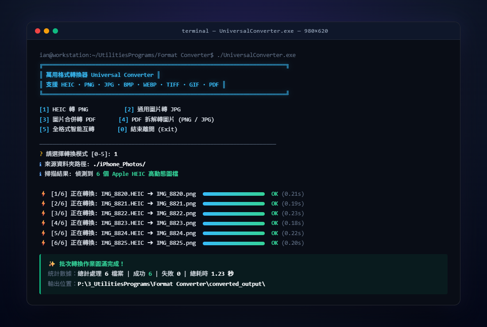

# FormatConverter

以命令列批次轉換 HEIC、圖片與 PDF 檔案格式

Batch-convert HEIC, images and PDFs with an interactive CLI.



[中文](#中文) · [English](#english)

## 中文

供需要批次轉換照片、圖片與 PDF 的人使用。`UniversalConverter` 提供互動選單，另有六支獨立腳本。

### 安裝與執行

安裝 Python 後，在儲存庫根目錄執行：

```powershell
python -m pip install Pillow pillow-heif PyMuPDF
python UniversalConverter/converter.py
```

`Pillow` 處理圖片，`pillow-heif` 讀取 HEIC/HEIF，`PyMuPDF` 以 `fitz` 匯入，處理 PDF。本專案的腳本未使用 pypdf 或 pdf2image，不需 Poppler。

### UniversalConverter

先選功能，再輸入來源資料夾路徑；直接按 Enter 使用程式或執行檔所在資料夾。程式只掃描該資料夾第一層，依檔名排序。

圖片輸入副檔名包含 `.heic`、`.heif`、`.png`、`.jpg`、`.jpeg`、`.bmp`、`.webp`、`.tiff`、`.tif`、`.gif`。

| 選項 | 轉換 | 輸出位置，皆相對於來源資料夾 |
| --- | --- | --- |
| 1 | 圖片轉 JPG、PNG、BMP、WEBP、TIFF 或 GIF | `converted_to_<格式>/`，例如 `converted_to_jpg/` |
| 2 | 每張圖片各存 PDF，或依檔名合併為一個 PDF | 個別檔案在 `converted_to_pdf/`；合併檔預設為 `combined.pdf` |
| 3 | PDF 每頁轉 JPG 或 PNG | `converted_to_jpg/` 或 `converted_to_png/` |
| 4 | 依檔名合併 PDF | 預設為 `merged.pdf`，可輸入其他檔名 |

PDF 圖片輸出的選單標示為 150、300、600 DPI；實作使用 1.5、3、6 倍縮放，預設 3 倍。單頁輸出沿用原檔名，多頁加上 `_page001`、`_page002` 等後綴。JPG 與 WEBP 的儲存品質參數為 95。

### 獨立腳本

將來源檔案放在下表的輸入位置，進入各程式子資料夾後執行同名 `.py`。例如：

```powershell
cd PDFtoPNG
python PDFtoPNG.py
```

| 子資料夾與同名程式 | 輸入格式 | 輸入位置 | 輸出位置 |
| --- | --- | --- | --- |
| `HEICtoPNG` | HEIC、HEIF → PNG | 目前工作資料夾，包含子資料夾 | 工作資料夾內的 `outputs/`，所有結果集中存放 |
| `IMGtoJPG` | PNG、BMP、WEBP、TIFF、GIF → JPG | 程式或執行檔所在資料夾 | 同位置的 `converted_jpgs/` |
| `IMGtoPDF` | PNG、JPG、JPEG → 合併或個別 PDF | 程式或執行檔所在資料夾 | `combined_output.pdf` 或 `converted_pdfs/` |
| `JPGtoPDF` | 嘗試將 JPG、JPEG、PNG 各轉成一個 PDF，見下方限制 | 目前工作資料夾 | `output/` |
| `PDFtoJPG` | 嘗試將 PDF 每頁轉 JPG，見下方限制 | 目前工作資料夾 | `output/` |
| `PDFtoPNG` | PDF 每頁轉 PNG，固定 12 倍縮放 | 目前工作資料夾 | `output/` |

`HEICtoPNG` 需要 Pillow 與 pillow-heif；`IMGtoJPG`、`IMGtoPDF` 需要 Pillow；`JPGtoPDF` 需要 PyMuPDF；`PDFtoJPG`、`PDFtoPNG` 需要 PyMuPDF 與 Pillow。除 `HEICtoPNG` 外，獨立腳本只掃描輸入資料夾第一層。兩支 PDF 轉圖片腳本的多頁檔名加上 `_page_1`、`_page_2` 等後綴。

目前 `PDFtoJPG.py` 將儲存格式寫成 `JPG`，Pillow 會回報格式錯誤；`JPGtoPDF.py` 將圖片物件傳給 `insert_pdf`，PyMuPDF 會回報來源不是 PDF。這兩種轉換可改用 UniversalConverter 的選項 3 與 2。

輸出同名時可能覆寫既有結果。`HEICtoPNG` 也會將不同子資料夾的同名來源寫到同一個輸出位置。

### 打包 Windows 執行檔

儲存庫提供原始碼與打包設定，沒有附執行檔。在儲存庫根目錄執行：

```powershell
cd UniversalConverter
.\build.bat
```

`build.bat` 會安裝或更新 Pillow、pillow-heif、PyMuPDF、PyInstaller，並從 `converter.py` 打包單檔終端程式 `萬用格式轉換器.exe`。

也可在 `UniversalConverter` 資料夾使用 spec 打包：

```powershell
python -m pip install pyinstaller
python -m PyInstaller UniversalConverter.spec
```

`UniversalConverter.spec` 的入口為 `converter.py`，輸出名稱為 `UniversalConverter.exe`；另一份 `converter.spec` 也以 `converter.py` 為入口，輸出名稱為 `萬用格式轉換器.exe`。

六支獨立腳本各附同名 `.spec`，入口與輸出名稱皆與腳本同名。進入對應子資料夾後，以 `PDFtoPNG` 為例：

```powershell
python -m PyInstaller PDFtoPNG.spec
```

### 授權

本專案採用 MIT License 授權開源。儲存庫尚未附授權檔。

## English

For people batch-converting photos, images and PDFs. `UniversalConverter` provides an interactive menu; six separate scripts are also included.

### Install and run

Install Python, then run these commands from the repository root:

```powershell
python -m pip install Pillow pillow-heif PyMuPDF
python UniversalConverter/converter.py
```

`Pillow` handles images, `pillow-heif` reads HEIC/HEIF, and `PyMuPDF`, imported as `fitz`, handles PDFs. The scripts use neither pypdf nor pdf2image and do not need Poppler.

### UniversalConverter

Choose a function, then enter a source folder. Press Enter to use the script or executable's folder. The program scans only that folder's top level, in filename order.

Image input extensions are `.heic`, `.heif`, `.png`, `.jpg`, `.jpeg`, `.bmp`, `.webp`, `.tiff`, `.tif` and `.gif`.

| Option | Conversion | Output relative to the source folder |
| --- | --- | --- |
| 1 | Images to JPG, PNG, BMP, WEBP, TIFF or GIF | `converted_to_<format>/`, such as `converted_to_jpg/` |
| 2 | Each image to a PDF, or images merged in filename order | Separate files in `converted_to_pdf/`; merged output defaults to `combined.pdf` |
| 3 | Each PDF page to JPG or PNG | `converted_to_jpg/` or `converted_to_png/` |
| 4 | PDFs merged in filename order | Defaults to `merged.pdf`; accepts another filename |

The PDF image menu labels its resolution choices as 150, 300 and 600 DPI; the implementation uses zoom factors of 1.5, 3 and 6, defaulting to 3. Single-page output keeps the original stem; multiple pages get suffixes such as `_page001` and `_page002`. JPG and WEBP use a quality setting of 95.

### Separate scripts

Put source files in the input location below, enter the script's subfolder and run the matching `.py` file. For example:

```powershell
cd PDFtoPNG
python PDFtoPNG.py
```

| Subfolder and matching script | Input and conversion | Input location | Output location |
| --- | --- | --- | --- |
| `HEICtoPNG` | HEIC, HEIF to PNG | Current working folder, including subfolders | `outputs/` in the working folder, with all results stored together |
| `IMGtoJPG` | PNG, BMP, WEBP, TIFF, GIF to JPG | Script or executable's folder | `converted_jpgs/` in that folder |
| `IMGtoPDF` | PNG, JPG, JPEG to merged or separate PDFs | Script or executable's folder | `combined_output.pdf` or `converted_pdfs/` |
| `JPGtoPDF` | Attempts to convert each JPG, JPEG or PNG to a PDF; see limitation below | Current working folder | `output/` |
| `PDFtoJPG` | Attempts to convert each PDF page to JPG; see limitation below | Current working folder | `output/` |
| `PDFtoPNG` | Each PDF page to PNG at a fixed 12x zoom | Current working folder | `output/` |

`HEICtoPNG` requires Pillow and pillow-heif; `IMGtoJPG` and `IMGtoPDF` require Pillow; `JPGtoPDF` requires PyMuPDF; `PDFtoJPG` and `PDFtoPNG` require PyMuPDF and Pillow. All separate scripts except `HEICtoPNG` scan only the input folder's top level. The two PDF-to-image scripts add suffixes such as `_page_1` and `_page_2` for multiple pages.

`PDFtoJPG.py` passes `JPG` as the save format, which Pillow rejects. `JPGtoPDF.py` passes an image document to `insert_pdf`, which PyMuPDF rejects because the source is not a PDF. Use UniversalConverter options 3 and 2 for these conversions.

Existing output files with the same name may be overwritten. `HEICtoPNG` also writes identically named sources from different subfolders to the same output path.

### Build a Windows executable

The repository includes source and build settings, with no executable included. From the repository root:

```powershell
cd UniversalConverter
.\build.bat
```

`build.bat` installs or updates Pillow, pillow-heif, PyMuPDF and PyInstaller, then builds `converter.py` as the single-file console program `萬用格式轉換器.exe`.

Alternatively, build with a spec from the `UniversalConverter` folder:

```powershell
python -m pip install pyinstaller
python -m PyInstaller UniversalConverter.spec
```

`UniversalConverter.spec` uses `converter.py` and names the output `UniversalConverter.exe`. The other spec, `converter.spec`, uses the same entry script and names the output `萬用格式轉換器.exe`.

Each of the six separate scripts has a matching `.spec`, with its entry script and output named after that script. Enter the corresponding subfolder, then build, for example:

```powershell
python -m PyInstaller PDFtoPNG.spec
```

### License

Released under the MIT License. The repository does not include a license file.
