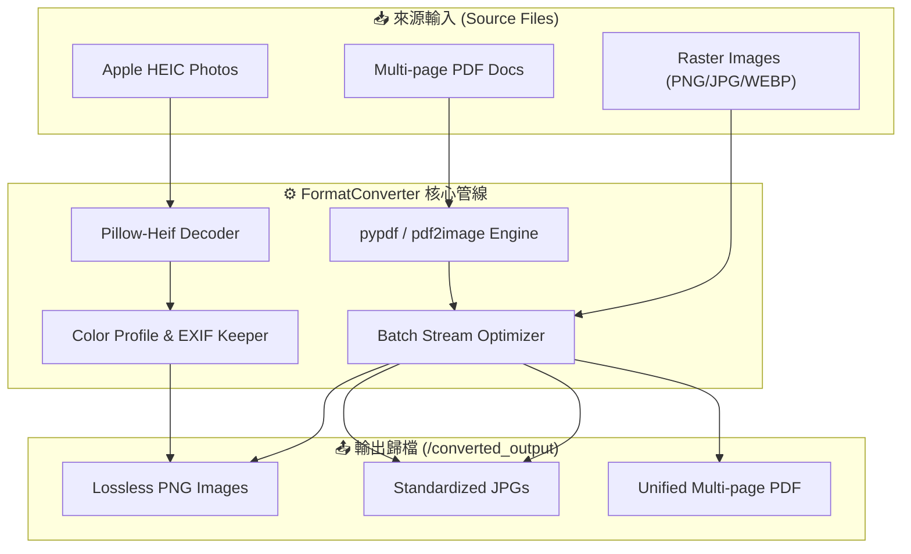

<div align="center">

# ⚡ FormatConverter

**Universal High-Performance Batch Media & Document Conversion Engine**

[](https://github.com/ian030590/FormatConverter/stargazers)
[](https://opensource.org/licenses/MIT)
[](https://www.python.org/)
[](https://github.com/ian030590/FormatConverter)
[](https://github.com/ian030590/FormatConverter/pulls)

<br />

<p align="center">
  
</p>

<p align="center">
  <b>高效輕量的多媒體與文件格式批次轉換工具箱，支援 Apple HEIC、高畫質圖檔與 PDF 雙向智慧互轉。</b>
</p>

</div>

---

## 📖 目錄 (Table of Contents)

- [產品簡介 (Overview)](#-產品簡介-overview)
- [核心優勢 (Key Highlights)](#-核心優勢-key-highlights)
- [支援格式矩陣 (Format Matrix)](#-支援格式矩陣-format-matrix)
- [系統架構 (System Architecture)](#-系統架構-system-architecture)
- [快速上手 (Quick Start)](#-快速上手-quick-start)
  - [模式 A：開箱即用 Portable EXE](#模式-a開箱即用-portable-exe)
  - [模式 B：Python 原始碼執行](#模式-bpython-原始碼執行)
- [專案結構 (Directory Structure)](#-專案結構-directory-structure)
- [常見問答 (FAQ)](#-常見問答-faq)
- [授權協議 (License)](#-授權協議-license)

---

## 🌟 產品簡介 (Overview)

**FormatConverter** 是一套專為臨床研究、行政文件處理與創作者打造的多格式轉換工具集。解決常見的跨裝置格式衝突（如 iPhone 拍攝的 Apple HEIC 照片無法在特定醫療或行政系統開啟、多頁掃描 PDF 需要批次轉為高解析度圖檔、大量圖片需要合併為標準報告 PDF 等問題）。

全工具採 **100% 離線本機運算**，無需上傳至任何雲端或第三方轉換網站，杜絕機密文件與個資外洩風險。

---

## ✨ 核心優勢 (Key Highlights)

- 🔒 **隱私零風險 (100% Offline)**：純本機記憶體串流處理，資料不離機。
- ⚡ **極速批次處理 (Batch Engine)**：支援多核心掃描，數十個檔案秒級完成轉換。
- 📱 **完整相容 Apple 生態 (HEIC Support)**：底層調用 `pillow-heif` 函式庫，精準保留原始色彩設定檔（Color Profiles）與 EXIF 資訊。
- 📄 **無損 PDF 雙向管線**：支援 PDF 高解析多頁渲染（PDF ➔ PNG/JPG）及多圖排版合併（Images ➔ PDF）。
- 🖥️ **雙模態支援**：提供全功能互動式終端選單（Universal Converter），同時提供各模組獨立極簡腳本與免安裝單一執行檔（.exe）。

---

## 📊 支援格式矩陣 (Format Matrix)

| 來源格式 (Source) | 目標格式 (Target) | 轉換模組 (Module) | 典型應用場景 |
| :--- | :--- | :--- | :--- |
| **Apple HEIC** | **PNG** | `HEICtoPNG` | iPhone/iPad 實體拍攝照片轉換為通用無損圖檔 |
| **通用圖片** (PNG, WebP, BMP, TIFF) | **JPG** | `IMGtoJPG` | 系統相容性最佳化、相簿壓縮匯入 |
| **多張圖片** (JPG, PNG, WebP) | **單一 PDF** | `IMGtoPDF` / `JPGtoPDF` | 醫療報告單據、合約發票批次掃描檔封存歸檔 |
| **多頁 PDF** | **高畫質圖片** (PNG / JPG) | `PDFtoPNG` / `PDFtoJPG` | 論文各頁抽圖、簡報製作與影像分析前處理 |
| **全格式 (All-in-One)** | **指定格式** | `UniversalConverter` | 一鍵互動選單自動掃描並轉出至隔離目錄 |

---

## 🏗️ 系統架構 (System Architecture)



---

## 🚀 快速上手 (Quick Start)

### 模式 A：開箱即用 Portable EXE

無需安裝 Python 環境，下載後直接雙擊執行：

1. 前往 `UniversalConverter/dist/`。
2. 雙擊執行 `UniversalConverter.exe`。
3. 依終端機彩色選單提示輸入數字（例如輸入 `1` 進行 HEIC 轉 PNG），輸入目標路徑後即可全自動完成。

### 模式 B：Python 原始碼執行

適用於開發者或 Linux/macOS 環境：

```bash
# 1. 複製專案
git clone https://github.com/ian030590/FormatConverter.git
cd FormatConverter/UniversalConverter

# 2. 安裝必要相依套件
pip install pillow pillow-heif pypdf pdf2image

# 3. 啟動萬用轉換器
python converter.py
```

若需單獨使用專用模組，直接進入子資料夾執行即可：

```bash
cd ../HEICtoPNG
python HEICtoPNG.py
```

---

## 📁 專案結構 (Directory Structure)

```text
Format Converter/
├── assets/
│   └── screenshot.png         # CLI 終端互動執行預覽展示圖
├── UniversalConverter/        # 萬用多格式整合轉換器 (支援全格式)
│   ├── converter.py           # 整合互動式彩色終端主程式
│   └── dist/
│       └── UniversalConverter.exe # 便攜版獨立執行檔
├── HEICtoPNG/                 # Apple HEIC 轉 PNG 專用輕量模組
├── IMGtoJPG/                  # 格式壓平轉 JPG 專用輕量模組
├── IMGtoPDF/                  # 多圖合成單一 PDF 專用輕量模組
├── JPGtoPDF/                  # JPG 組合轉 PDF 專用模組
├── PDFtoJPG/                  # PDF 頁面解構轉 JPG 模組
├── PDFtoPNG/                  # PDF 頁面解構轉 PNG 模組
└── README.md                  # 專案詳細說明與技術文檔
```

---

## ❓ 常見問答 (FAQ)

<details>
<summary><b>Q1: 轉換過程中圖片解析度或品質是否會下降？</b></summary>
預設採用最高品質無損或接近無損參數（PNG 採用無損壓縮；JPG 預設輸出品質 95% 並保留最大動態範圍）。
</details>

<details>
<summary><b>Q2: 支援單一檔案還是整個資料夾批次掃描？</b></summary>
兩者皆支援！您可以直接輸入資料夾路徑，程式會自動遍歷並過濾目標副檔名進行批次處理，並將成果存放至 `converted_output/`，絕不覆蓋原始資料。
</details>

---

## 📄 授權協議 (License)

本專案採用 [MIT License](LICENSE) 授權開源。歡迎學術機構、醫療單位與個人自由使用、修改與整合。

<div align="center">
  <sub>Crafted with ❤️ by <a href="https://github.com/ian030590">Ian</a>.</sub>
</div>
